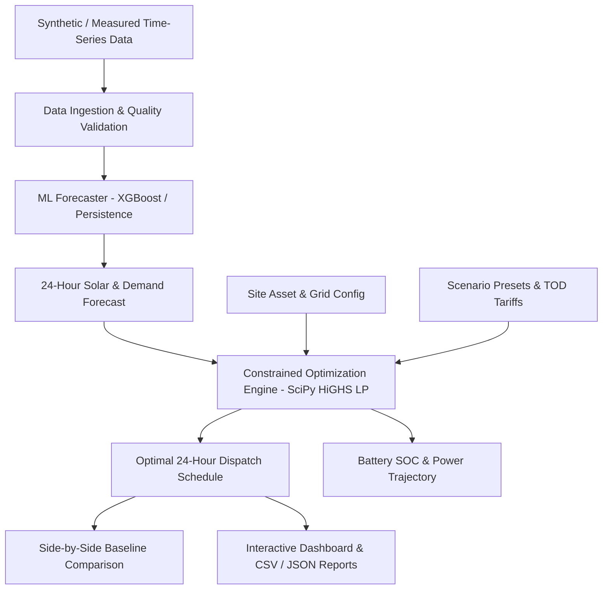

# EnerShare AI
## Intelligent Renewable Energy Exchange and Smart Storage Optimization Platform

**Tagline:** *Predict. Store. Share. Optimize.*  
**System Classification:** Autonomous Energy Management System (EMS) & Storage Optimization Engine  
**Release:** Enterprise Edition v1.0.0  

---

## 1. Executive Summary

**EnerShare AI** is an intelligent software platform that connects renewable energy generation (solar PV), facility load, battery energy storage systems (BESS), and power grid exchange through a unified machine learning and mathematical optimization workflow.

- **AI Forecasting Engine:** Chronological train/validation using XGBoost and Scikit-Learn Gradient Boosting to predict 24-hour solar generation and facility electricity demand without lookahead bias.
- **Constrained Optimization Engine:** Formulated as a Linear Program (LP) solved with SciPy HiGHS (with deterministic priority fallback). Strictly enforces conservation of energy, battery State-of-Charge (SOC) operating limits ($20\% \le SOC \le 95\%$), inverter charge/discharge power limits, grid import/export bounds, and Time-of-Day (TOD) dynamic tariffs.
- **Scenario Simulator & Baseline Comparison:** Benchmarks the LP optimizer directly against standard priority dispatch strategies, calculating exact operating cost savings in Indian Rupees (₹), grid import reductions (kWh), and clean self-consumption improvements (%).
- **Interactive Web Interface:** Modern, responsive, professional enterprise white application built with HTML5, custom CSS design system, and Chart.js visualizations.
- **Reporting & Auditing:** Real-time CSV export, JSON export, and an Executive Briefing card for stakeholder verification.

---

## 2. Architecture & Tech Stack



### Backend Components
- **Framework:** FastAPI with Python 3.10+ & SQLModel / SQLite
- **Machine Learning:** `xgboost` & `scikit-learn` (Lagged features, rolling statistics, cyclical time encodings)
- **Mathematical Optimization:** `scipy.optimize.linprog` (HiGHS Simplex & Interior-Point solver) & PuLP
- **Data Processing:** `pandas` & `numpy`

### Frontend Components
- **Design System:** Custom Enterprise White CSS system with high-contrast typography and responsive layout
- **Visualizations:** Chart.js (Real-time Energy Flow, Battery SOC Envelope, Forecast vs Actual, Comparison Bar)
- **Controller:** Native ES6 JavaScript with modular API client

---

## 3. Quick Start & Startup Guide

### Prerequisites
- Python 3.10+
- All required packages are listed in `backend/requirements.txt`

### Launching the Application
Open a terminal in the project directory and run:

```bash
cd backend
python -m uvicorn app.main:app --host 0.0.0.0 --port 8000 --reload
```

Or double-click the included `start_enershare.bat` file on Windows.

Open your browser at:
**[http://localhost:8000/](http://localhost:8000/)**

The FastAPI server automatically serves the frontend interface, mounts interactive API documentation at `http://localhost:8000/docs`, and seeds default industrial scenarios and demo profiles on first run.

---

## 4. Automated Verification & Test Results

Run all backend unit and API integration tests:

```bash
cd backend
python tests/test_backend.py
python tests/test_api_endpoints.py
```

### Verified Test Summary
- **Demo Data Generation:** `[PASS]` 7-day & 30-day non-negative realistic generation & load curves.
- **AI Forecaster (XGBoost):** `[PASS]` Chronological split training, feature engineering, and 24h horizon predictions.
- **Optimizer Physical Bounds:** `[PASS]` Energy balance conservation ($ru + bc + ge + cu = gen$), battery SOC bounds ($20\% \le SOC \le 95\%$), power ratings, grid limits.
- **Baseline vs Optimizer:** `[PASS]` Mathematical proof that LP optimizer matches or beats simple priority dispatch in operational cost.
- **REST Endpoints:** `[PASS]` All 10 API endpoints (`/health`, `/config`, `/datasets/demo`, `/scenarios`, `/forecast`, `/optimize`, `/optimize/compare`, `/optimize/kpi`, `/reports/export/csv`, `/reports/summary`).

---

## 5. Demonstration Workflow

1. **Executive Dashboard (`#tab-dashboard`):** View real-time KPI cards (Generation, Load, Battery SOC, Grid Import, Cost in ₹, Renewable Self-Consumption %). Inspect the 24-hour energy balance chart showing solar generation curve and peak battery discharge.
2. **AI Forecasting Hub (`#tab-forecast`):** Select target (Solar Generation or Load), pick model (XGBoost), click **"Train & Forecast 24h Horizon"**, and evaluate MAE/RMSE metrics alongside prediction confidence.
3. **Constrained Optimization (`#tab-optimization`):** Select scenarios (e.g. *Solar Surplus*, *Evening Deficit*, *High Peak Tariff*), click **"Run Constrained Optimization"**, and inspect the 24-interval dispatch schedule table with interval-by-interval action explanations and battery SOC tracking.
4. **Scenario Comparison (`#tab-scenarios`):** Click **"Run Comparative Simulation"** to evaluate the exact Rupee savings (₹) and grid import reductions achieved by the optimization engine compared to unoptimized heuristic dispatch.
5. **Site & Asset Config (`#tab-config`):** Adjust battery size, solar PV capacity, grid import limits, or net-metering toggles to simulate facility modifications.
6. **Reports & Audit (`#tab-reports`):** Download 24-hour interval schedule CSV or JSON, and inspect the executive briefing report.
